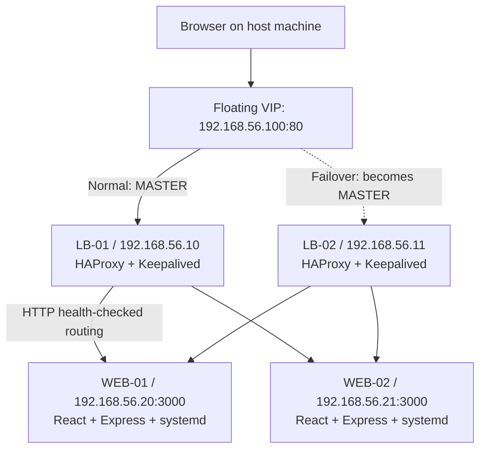

# Highly Available React Application Infrastructure

**Linux System Administration & DevOps — Homework and Optional Bonus Challenges**

## Table of contents

1. [Project overview](#1-project-overview)
2. [Architecture and networking](#2-architecture-and-networking)
3. [Technologies and repository structure](#3-technologies-and-repository-structure)
4. [Reproducing the base homework](#4-reproducing-the-base-homework)
5. [Implementation by assignment task](#5-implementation-by-assignment-task)
6. [Required failure testing (Task 6)](#6-required-failure-testing-task-6)
7. [Optional bonus challenges](#7-optional-bonus-challenges)
8. [Screenshot evidence index](#8-screenshot-evidence-index)
9. [Testing summary](#9-testing-summary)
10. [Limitations and troubleshooting](#10-limitations-and-troubleshooting)

---

## 1. Project overview

This project demonstrates **service-level high availability** for a React web application, using four Ubuntu virtual machines. Two VMs serve the same React production build. Two other VMs run HAProxy and Keepalived to provide HTTP load balancing and automatic virtual-IP (VIP) failover.

### Objectives

- Provision four Linux servers from one `Vagrantfile` with reproducible networking and SSH access.
- Build and run a React application on two backend servers using a non-root systemd service.
- Configure **round-robin** distribution and HTTP health checks in HAProxy.
- Configure **Keepalived VRRP** so one load balancer owns `192.168.56.100` at a time.
- Automate setup, deployment, health verification, service management, and resource reporting using Bash and Just.
- Demonstrate continuity when a web server or the preferred load balancer fails.
- Optionally implement authenticated HAProxy statistics, versioned GitHub releases, rollback, and rolling deployment.

### Application dashboard

The React application is an **infrastructure observability dashboard** rather than a generic demo page. It polls an endpoint to display:

- The **load balancer handling the diagnostic HTTP response** (`LB-01` or `LB-02`), supplied by the HAProxy `X-Load-Balancer` response header.
- The **backend handling that particular request** (`WEB-01` or `WEB-02`), supplied at runtime by the Express `/api/trace` endpoint.
- Sampled request history, observed backend distribution, and response latency.

The UI's route information describes **individual diagnostic requests**. It does not identify the backend used for every asset request, prove full infrastructure health, or measure all users' traffic.

**Final dashboard evidence:** [`screenshots/11-vip-dashboard.png`](screenshots/11-vip-dashboard.png) — capture the application opened at `http://192.168.56.100` with its observed LB and backend labels visible.

## 2. Architecture and networking



> The VIP is assigned to **only one** load balancer at a time. The dashed arrow represents the failover alternative, not simultaneous VIP ownership. Both HAProxy instances are running, but only the VIP owner normally receives requests addressed to the VIP.

### VM specification

| VM | Static host-only IP | CPU | RAM | Primary services |
|---|---|---:|---:|---|
| `lb-01` | `192.168.56.10` | 1 vCPU | 512 MB | HAProxy, Keepalived (VRRP priority 150) |
| `lb-02` | `192.168.56.11` | 1 vCPU | 512 MB | HAProxy, Keepalived (VRRP priority 100) |
| `web-01` | `192.168.56.20` | 1 vCPU | 1024 MB | Express/React, `react-app.service` |
| `web-02` | `192.168.56.21` | 1 vCPU | 1024 MB | Express/React, `react-app.service` |
| **VIP** | **`192.168.56.100`** | — | — | Floating address maintained by Keepalived |

**Network design:** VirtualBox provides a **NAT adapter** for outbound internet/package access and a **host-only adapter** for host-to-VM and VM-to-VM traffic on `192.168.56.0/24`. In these VMs, the interfaces are `eth0` (NAT) and `eth1` (host-only). Keepalived attaches the VIP to `eth1`. Interface names can differ with other VM images and must then be updated in configuration.

**Request flow:** Browser → VIP → active HAProxy frontend on port 80 → healthy Express server on port 3000 → React assets or JSON API response. HAProxy probes `GET /health` and expects HTTP 200. Keepalived watches the local HAProxy service and transfers VIP ownership when the preferred node becomes unavailable/unhealthy.

### Relevant endpoints

| Endpoint | Purpose |
|---|---|
| `http://192.168.56.20:3000` / `.21:3000` | Direct dashboard access to each web server |
| `http://192.168.56.10` / `.11` | Direct access through each load balancer |
| `http://192.168.56.100` | Stable application endpoint through the VIP |
| `/health` | HTTP 200 (`OK`) application health check |
| `/api/trace` | Runtime backend identity; HAProxy adds `X-Load-Balancer` |
| `http://192.168.56.10:8404/haproxy-stats` / `.11:8404/haproxy-stats` | Protected HAProxy statistics (**bonus mode only**) |

## 3. Technologies and repository structure

| Technology | Purpose |
|---|---|
| Vagrant + VirtualBox | Four repeatable Ubuntu 24.04 VM definitions |
| Bash + Just | Setup automation, command shortcuts, deployment and tests |
| React + Vite | Frontend dashboard and production static build |
| Node.js + Express | Serve static assets and runtime `/health` and `/api/trace` routes |
| systemd | Launch/restart the web-server process under `reactapp` |
| HAProxy | HTTP reverse proxy, round-robin load balancing and backend checks |
| Keepalived | VRRP election, tracked HAProxy health, floating VIP |
| Git/GitHub (**bonus**) | Source-controlled deployment by commit identifier |
| HAProxy Runtime API (**bonus**) | Drain/restore backends during rolling deployments |

```text
ha-react-homework/
├── README.md
├── Justfile
├── Vagrantfile
├── react-app/
│   ├── src/
│   ├── server.mjs
│   ├── package.json
│   ├── package-lock.json
│   └── deploy/react-app.service
├── haproxy/
│   ├── lb-01.cfg
│   └── lb-02.cfg
├── keepalived/
│   ├── lb01.conf
│   └── lb02.conf
├── scripts/
│   ├── setup-web.sh
│   ├── setup-lb.sh
│   ├── deploy-react.sh
│   ├── check-health.sh
│   ├── service-manager.sh
│   └── server-report.sh
├── bonus/                   # Optional upgrade layer
│   ├── bootstrap-bonus.sh
│   ├── setup-lb-bonus.sh
│   ├── init-release.sh
│   ├── install-release.sh
│   ├── lb-control.sh
│   ├── rolling-release.sh
│   ├── deploy-github.sh
│   └── check-bonus.sh
├── tests/
│   └── TEST-RESULTS.md
└── screenshots/
    └── ...                  # Student's test evidence (see Section 8)
```

Generated `.vagrant/`, `node_modules/`, `react-app/dist/`, and `.artifacts/` files should be excluded from Git. Do not commit passwords, credentials, or private SSH keys.

## 4. Reproducing the base homework

### Prerequisites

- VirtualBox and Vagrant installed and compatible with the host OS.
- Git, Bash, `curl`, and [Just](https://github.com/casey/just) installed on the host.
- Node.js 22 + npm available on the host for React builds (the `setup-web.sh` script installs Node.js 22 in the web VMs).
- Sufficient host resources for approximately **3 GiB allocated guest RAM** plus the host operating system and virtualization overhead.
- A working VirtualBox **host-only network** using `192.168.56.0/24`.
- All commands below executed in a host shell from the repository root, unless explicitly marked as VM commands. Windows users may use Git Bash or another Bash-compatible environment with Vagrant available.

### Base mode: original homework only

```bash
# See recipes and validate configuration
just --list
just validate

# Recreate the four VMs, deploy React, configure HAProxy/Keepalived
just bootstrap

# Verify the running infrastructure
just status
just health-all
just validate-lb
just vip
just trace
```

`just bootstrap` runs the following sequence: `up` → `setup-web` → `deploy` → `setup-lb` → `health-all`. It does **not** enable bonus releases or statistics. Setup uses the host folder mounted at `/vagrant` inside each VM.

### Useful base commands

| Command | Action |
|---|---|
| `just up` | Start all VMs |
| `just down` | Shut down VMs while retaining their disks |
| `just status` | Inspect VM state |
| `just ssh web-01` | Enter a specific VM |
| `just setup-web` | Install web-server dependencies on both web VMs |
| `just setup-lb` | Install/configure HAProxy + Keepalived (backup first) |
| `just deploy` | Build React on host, deploy to two backend VMs |
| `just health` / `just health-all` | Test backend-only / all five HTTP endpoints |
| `just report web-01` | Show a VM's hostname, IPs and resource usage |
| `just service web-01 status` | Manage/inspect `react-app.service` |
| `just logs-web web-01` | Show recent React systemd logs |
| `just logs-lb lb-01 keepalived` | Show Keepalived or HAProxy logs |
| `just destroy DESTROY` | **Permanently delete all four VM disks** |

> `just destroy DESTROY` is destructive. It deletes applications, service configuration, logs, and release folders stored inside VMs. The Git repository on the host remains, allowing a fresh `just bootstrap`. A clean rebuild must be verified on the actual host; do not infer it succeeded only because scripts exist.

## 5. Implementation by assignment task

### Task 1 — Vagrant infrastructure (15 points)

All four machines are specified in one `Vagrantfile`, with static host-only IPs, hostnames, CPU/RAM settings, SSH access, and NAT for package installation.

**Verification commands:**

```bash
just status
vagrant ssh web-01 -c 'hostname; ip -br addr; ping -c 4 192.168.56.10; ping -c 4 192.168.56.21'
vagrant ssh web-01 -c 'curl -I --max-time 10 https://example.com'
```

**Screenshots:** [VM status](screenshots/01-vm-status.png) and [private network connectivity](screenshots/02-private-network.png).

### Task 2 — React + systemd deployment (20 points)

The **same React production build** is installed on WEB-01 and WEB-02. The application uses an Express server on port 3000; `react-app.service` starts it at boot and restarts it after failures under the dedicated non-root `reactapp` user. Environment variables (`SERVER_ID`, `WEB_IP`) supply each VM's runtime identity.

**Verification commands:**

```bash
curl -i http://192.168.56.20:3000/health
curl -i http://192.168.56.21:3000/health
curl -s http://192.168.56.20:3000/api/trace
curl -s http://192.168.56.21:3000/api/trace
vagrant ssh web-01 -c 'sudo systemctl status react-app --no-pager'
vagrant ssh web-02 -c 'sudo systemctl status react-app --no-pager'
```

**Screenshots:** [WEB-01 dashboard](screenshots/03-web01-dashboard.png), [WEB-02 dashboard](screenshots/04-web02-dashboard.png), and [systemd status for both VMs](screenshots/05-systemd-services.png).

### Task 3 — HAProxy load balancing (20 points)

Both load balancers listen on port 80. Each forwards traffic to WEB-01 and WEB-02 using `balance roundrobin`. Periodic `GET /health` checks remove unhealthy backends and return them to service after recovery.

HAProxy adds `X-Load-Balancer: LB-01` or `LB-02` to HTTP responses so the dashboard can identify the load balancer handling the request.

**Verification commands:**

```bash
just validate-lb
curl -i http://192.168.56.10/api/trace
curl -i http://192.168.56.11/api/trace
for i in $(seq 1 8); do curl -fsS http://192.168.56.10/api/trace | grep -o '"backend":"[^"]*"'; done
```

**Screenshots:** [configuration validation](screenshots/06-lb-validation.png), [LB-01 route](screenshots/07-lb01-routing.png), [LB-02 route](screenshots/08-lb02-routing.png), and [round-robin responses](screenshots/09-round-robin.png).

### Task 4 — Keepalived and VIP failover (20 points)

Keepalived runs on both load balancers with VRRP ID `51`, unicast peers, and priorities `150` (LB-01) and `100` (LB-02). Its tracked check uses `systemctl is-active --quiet haproxy`, a zero tracking weight, and failure/recovery thresholds. The preferred healthy master owns `192.168.56.100/24` on `eth1`. After failover, the browser continues using the same VIP endpoint.

**Verification commands:**

```bash
just vip
just trace
curl -i http://192.168.56.100/api/trace
```

**Screenshots:** [VIP ownership on both LBs](screenshots/10-vip-owner.png) and [application accessed through the VIP](screenshots/11-vip-dashboard.png). Failover evidence is captured in Task 6 below.

### Task 5 — Bash automation (15 points)

| Script | Purpose | Suggested demonstration |
|---|---|---|
| `setup-web.sh` | Install Node.js and create `reactapp` runtime environment | `just setup-web` |
| `deploy-react.sh` | Build once and deploy to WEB-01 then WEB-02 | `just deploy` (**base mode only**) |
| `check-health.sh` | Check backend health and optional LB/VIP endpoints | `just health-all` |
| `service-manager.sh` | Validate actions and operate `react-app.service` | `just service web-01 status` |
| `server-report.sh` | Print host/IP, uptime, CPU, memory, disk | `just report web-01` |
| `setup-lb.sh` | Additional automation for HAProxy/Keepalived | `just setup-lb` |

Scripts use functions, variables, validation, loops, command exit codes, error messages, and no hardcoded passwords. `Justfile` is a convenient command runner **on top of** those scripts.

**Screenshots:** [health/automation output](screenshots/12-automation-health.png) and [server report](screenshots/13-server-report.png). For full script evidence, include [deployment output](screenshots/14-base-deployment.png) captured **before enabling bonus mode**.

## 6. Required failure testing (Task 6)

**Testing rule:** Run one failure scenario at a time. Record the date/time, executed commands, actual output, observed UI behavior, and relevant logs. Restore the failed service or VM and confirm normal health **before moving to the next test**. A few unsuccessful requests during VIP failover are permitted by the homework; they must be recorded rather than hidden.

| Test | Procedure (host unless noted) | Expected result | Actual result | Screenshot |
|---|---|---|---|---|
| **T6.1** WEB-01 fails | `just fail-web web-01`; then `just trace` | Requests through VIP continue via WEB-02 after health-check detection | **Not recorded** | [15-web01-down.png](screenshots/15-web01-down.png) |
| **T6.2** WEB-01 rejoins | `just recover-web web-01`; repeat `/api/trace` requests | Both WEB-01 and WEB-02 receive new requests | **Not recorded** | [16-web01-rejoined.png](screenshots/16-web01-rejoined.png) |
| **T6.3** HAProxy on LB-01 fails | `just fail-lb lb-01`; `just vip`; `just trace` | VIP moves to LB-02 and response header becomes `LB-02` | **Not recorded** | [17-haproxy-failover.png](screenshots/17-haproxy-failover.png) |
| **T6.4** LB-01 VM shuts down | Restore LB-01 first; `vagrant halt lb-01`; verify via LB-02 and `just trace` | LB-02 owns VIP; site remains accessible | **Not recorded** | [18-lb01-shutdown.png](screenshots/18-lb01-shutdown.png) |
| **T6.5** LB-01 recovers | `vagrant up lb-01`; `just vip`; `just trace` | Healthy higher-priority LB-01 reclaims VIP under default preemption | **Not recorded** | [19-lb01-failback.png](screenshots/19-lb01-failback.png) |
| **T6.6** WEB-01 reboots | `just reload web-01`; `just service web-01 status` | `react-app.service` starts automatically after reboot | **Not recorded** | [20-web01-reboot.png](screenshots/20-web01-reboot.png) |

After T6.3, **restore HAProxy before doing the VM shutdown test**:

```bash
just recover-lb lb-01
just health-all
```

After T6.4/T6.5, ensure `vagrant status` shows LB-01 running again. During T6.4, **do not use `just vip`** because it tries to SSH into both load balancers and LB-01 is offline. Check only LB-02:

```bash
vagrant ssh lb-02 -c 'ip -4 addr show dev eth1'
just trace
```

Capture Keepalived transition logs after T6.3 and T6.5:

```bash
just logs-lb lb-01 keepalived
just logs-lb lb-02 keepalived
```

**Logs screenshot:** [VRRP failover and recovery](screenshots/21-keepalived-logs.png). Also record observed results and timestamps in [`tests/TEST-RESULTS.md`](tests/TEST-RESULTS.md).

### Example result entry — complete it with real evidence

```text
Test ID: T6.3 — HAProxy failure on LB-01
Date/time: [fill in]
Command(s): just fail-lb lb-01; just trace; just vip
Before: X-Load-Balancer: [actual]
After:  X-Load-Balancer: [actual]
VIP on: [observed owner]
Outcome: [PASS / FAIL]
Relevant logs: [timestamps / lines]
Screenshot: screenshots/17-haproxy-failover.png
Recovery command: just recover-lb lb-01
```

## 7. Optional bonus challenges

The optional challenges are **separate from base mode**. The base `just bootstrap` remains unchanged. Start from a healthy base environment and apply `just bootstrap-bonus` as a second layer.

### Bonus setup: upgrade a running base deployment

```bash
just bootstrap           # Only for a clean/rebuilt environment
just health-all
just bootstrap-bonus
just bonus-status
just releases
```

`bootstrap-bonus` configures HAProxy's authenticated statistics page and Runtime API socket on each LB. It also converts the existing `/opt/react-app` deployment into a preserved `baseline` release and points the systemd service to `/opt/react-app/current` (a release symlink). This does not alter the Keepalived VIP configuration.

```text
/opt/react-app/
├── dist/                      # Old base files retained
├── server.mjs                 # Old base server retained
├── releases/
│   ├── baseline/
│   └── <git-commit-sha>/
└── current -> releases/<active-release>
```

**Bonus setup evidence:** [active `baseline` release on both web VMs](screenshots/24-bonus-baseline.png).

> **Do not run `just deploy` in bonus mode.** That command uses the original flat deployment path. Use `just deploy-github`, `just deploy-release`, or `just rollback` for versioned deployments. To return to a *pure base environment*, recreate the VMs with `just destroy DESTROY` followed by `just bootstrap`.

### Bonus A — GitHub deployment with rollback (+5)

```bash
# Git must have a valid origin remote. Commit react-app/package-lock.json.
git remote -v
just deploy-github main
just releases
just bonus-status

# Roll both servers back to the pre-bonus release
just rollback baseline
just releases
just bonus-status
```

The script fetches the selected GitHub branch, builds the checked-out Git commit **once on the host** into `.artifacts/releases/<short-commit-id>`, stages the release on both VMs, and activates it one backend at a time. A failed activation attempts to restore the previous release on that backend; if a multi-node rollout partially succeeds, use an explicit rollback to re-align both servers.

**Screenshots:** [GitHub release ID on both nodes](screenshots/25-bonus-github-release.png) and [rollback to `baseline`](screenshots/26-bonus-rollback.png). Capture the command outputs and resulting `just releases` values. Do not display Git credentials or secrets.

### Bonus B — Protected HAProxy statistics (+5)

```bash
just stats
# Expected: login required when no credentials are supplied
curl -s -o /dev/null -w '%{http_code}\n' \
  http://192.168.56.10:8404/haproxy-stats
```

Expected unauthenticated status: **HTTP 401**. Open either statistics URL in a browser and authenticate with username `viewer` and the password generated **on that VM**. The password is stored locally as root-only `/etc/ha-react/monitoring-password` and can be retrieved using `just stats-password lb-01` or `just stats-password lb-02`. **Never capture or upload a screenshot showing the password.**

The statistics listeners bind to the load balancers' host-only addresses on port `8404` and restrict access to the lab subnet. These are HTTP pages on a trusted, isolated lab—not an internet-ready monitoring service.

**Screenshots:** [HTTP 401 before login](screenshots/22-bonus-stats-401.png) and [authenticated HAProxy statistics showing backend health](screenshots/23-bonus-stats-dashboard.png).

### Bonus C — Rolling deployment with an availability test (+5)

During a release, `rolling-release.sh` verifies that the other backend is healthy, drains the backend being updated **on both load balancers**, waits for active sessions to drain, activates the target release, checks health, and restores that backend before updating the next one. HAProxy control uses `/run/haproxy/admin.sock` on each LB.

**Terminal A: generate and record repeated requests through the VIP** (run from repository root):

```bash
mkdir -p tests/results
while true; do
  if curl -fsS --max-time 3 -o /dev/null http://192.168.56.100/health; then
    printf '%s PASS\n' "$(date -Is)"
  else
    printf '%s FAIL\n' "$(date -Is)"
  fi
  sleep 0.5
done | tee tests/results/rolling-monitor.log
# Stop with Ctrl+C after deployment completes
```

**Terminal B:**

```bash
just deploy-github main
# Or deploy an already-built release:
# just deploy-release <release-id>
```

After stopping Terminal A, evaluate the recorded results:

```bash
grep -c ' PASS$' tests/results/rolling-monitor.log || true
grep -c ' FAIL$' tests/results/rolling-monitor.log || true
just bonus-status
```

**Screenshot:** [rolling deployment and uninterrupted VIP request stream](screenshots/27-bonus-rolling.png). Record the actual PASS/FAIL counts. A zero-failure observation during this test supports the bonus demonstration, but does **not** prove zero downtime for every client or persistent connection.

### Bonus reproducibility: clean rebuild (recommended evidence)

After **committing your configuration** and saving all screenshots/test logs, run this only if you are prepared to delete all four VMs:

```bash
just destroy DESTROY
just bootstrap
just health-all
just bootstrap-bonus
just bonus-status
```

**Screenshot:** [successful rebuild + bonus reinstallation](screenshots/28-bonus-rebuild.png). A VM destroy also removes local service logs, secrets and release directories, so preserve evidence first.

## 8. Screenshot evidence index

**Capture these images yourself** and save using the **exact filenames below** in `screenshots/` so GitHub links resolve. Capture readable terminal commands **and output** where possible. For browser screenshots, include the address bar and visible server identification. If results differ from expectation, document the actual observation instead of changing the expected behavior.

| ID | File to add | What the screenshot must prove | Importance |
|---|---|---|---|
| 01 | `01-vm-status.png` | Four running Vagrant VMs (`just status`) | Required |
| 02 | `02-private-network.png` | `eth1` private IP and successful cross-VM ping | Required |
| 03 | `03-web01-dashboard.png` | Direct WEB-01 dashboard reports WEB-01 | Required |
| 04 | `04-web02-dashboard.png` | Direct WEB-02 dashboard reports WEB-02 | Required |
| 05 | `05-systemd-services.png` | Enabled/running React service on both VMs | Required |
| 06 | `06-lb-validation.png` | HAProxy and Keepalived configurations validate on both LBs | Required |
| 07 | `07-lb01-routing.png` | LB-01 route, header and backend identity | Required |
| 08 | `08-lb02-routing.png` | LB-02 route, header and backend identity | Required |
| 09 | `09-round-robin.png` | Multiple HTTP requests distributed to WEB-01 and WEB-02 | Required |
| 10 | `10-vip-owner.png` | Only LB-01 owns `.100` when both LBs are healthy | Required |
| 11 | `11-vip-dashboard.png` | React dashboard reachable at VIP URL | Required |
| 12 | `12-automation-health.png` | `just health-all` reports five successful HTTP checks | Required |
| 13 | `13-server-report.png` | Resource report includes CPU, RAM, disk, IP and uptime | Required |
| 14 | `14-base-deployment.png` | Base automation deploys React to both web VMs | Recommended |
| 15 | `15-web01-down.png` | Stop WEB-01; VIP continues through WEB-02 | **Required Task 6** |
| 16 | `16-web01-rejoined.png` | Restore WEB-01; both backends receive traffic | **Required Task 6** |
| 17 | `17-haproxy-failover.png` | Stop LB-01 HAProxy; response changes to LB-02 | **Required Task 6** |
| 18 | `18-lb01-shutdown.png` | LB-01 VM halted; VIP still available via LB-02 | **Required Task 6** |
| 19 | `19-lb01-failback.png` | LB-01 restored; VIP follows configured failback | **Required Task 6** |
| 20 | `20-web01-reboot.png` | WEB-01 rebooted; systemd starts React automatically | **Required Task 6** |
| 21 | `21-keepalived-logs.png` | Timestamped MASTER/BACKUP/FAULT or ownership transitions | Required supporting log |
| 22 | `22-bonus-stats-401.png` | Monitoring endpoint rejects unauthenticated requests | Bonus |
| 23 | `23-bonus-stats-dashboard.png` | Authenticated HAProxy statistics list both backend states | Bonus |
| 24 | `24-bonus-baseline.png` | Bonus migration preserves the `baseline` release | Bonus |
| 25 | `25-bonus-github-release.png` | Both web VMs running the selected Git commit release | Bonus |
| 26 | `26-bonus-rollback.png` | Both web VMs restored to the previous release | Bonus |
| 27 | `27-bonus-rolling.png` | Concurrent rolling rollout and VIP request health results | Bonus |
| 28 | `28-bonus-rebuild.png` | Base and bonus successfully reprovisioned after destroy | Recommended bonus |

**Tip:** If the instructor requests fewer images, combine related terminal outputs into a single readable capture, but do not omit the six mandatory Task 6 failure scenarios. See [`SCREENSHOT-GUIDE.md`](SCREENSHOT-GUIDE.md) for a capture-by-capture command walkthrough.

## 9. Testing summary

Complete this table **after** performing the tests and adding evidence. Use **PASS**, **FAIL**, **NOT TESTED** (not performed), or **NOT RECORDED** (performed but evidence not entered) and include the execution date.

| Area | Expected evidence | Actual outcome | Test date |
|---|---|---|---|
| Task 1 — Infrastructure | Four VMs, private connectivity, internet | **NOT RECORDED** | — |
| Task 2 — React + systemd | Two direct endpoints, non-root systemd services | **NOT RECORDED** | — |
| Task 3 — HAProxy | Round-robin, `/health`, valid configuration | **NOT RECORDED** | — |
| Task 4 — Keepalived | One VIP owner, LB failover | **NOT RECORDED** | — |
| Task 5 — Bash automation | All required scripts demonstrated | **NOT RECORDED** | — |
| Task 6 — Failure testing | Six recorded scenarios with screenshots/logs | **NOT RECORDED** | — |
| Bonus A — GitHub / rollback | Versioned release and successful rollback | **NOT RECORDED** | — |
| Bonus B — HAProxy stats | HTTP 401 and authenticated statistics | **NOT RECORDED** | — |
| Bonus C — Rolling release | Concurrent VIP request results, no unexpected failures | **NOT RECORDED** | — |

**Conclusion (fill in from evidence):** [Summarize what succeeded, any brief failover interruptions observed, the actual release IDs used, and any remaining limitations.]

## 10. Limitations and troubleshooting

### Expected limitations

- All four VMs share **one physical computer**: this provides **service-level** high availability, not physical-host redundancy.
- The lab uses **HTTP** and private IP addresses. Public deployment needs DNS, TLS, firewall controls, and stronger secrets handling.
- Normal HAProxy and Keepalived failover can cause a brief interruption; the assignment explicitly permits brief VIP failover interruptions.
- The React dashboard observes browser-generated diagnostic requests, **not** all HAProxy connections or real-time kernel/VRRP state.
- Base `just deploy` updates backends sequentially but **does not guarantee zero downtime**. Bonus rolling deployment reduces disruption and must be tested.
- Do not use base `just deploy` after activating bonus release mode. A clean return to base mode requires rebuilding the VMs.

### Diagnostic commands

```bash
just status
just health-all
just vip
just trace
just validate-lb
just logs-web web-01
just logs-lb lb-01 haproxy
just logs-lb lb-01 keepalived
just bonus-status                 # Bonus mode only
```

If `just vip` shows the VIP on both LBs, investigate VRRP communication rather than treating it as a successful failover. If all backend health checks fail, HAProxy may return HTTP 503. If systemd fails, inspect `journalctl -u react-app` on the relevant web server.

---
